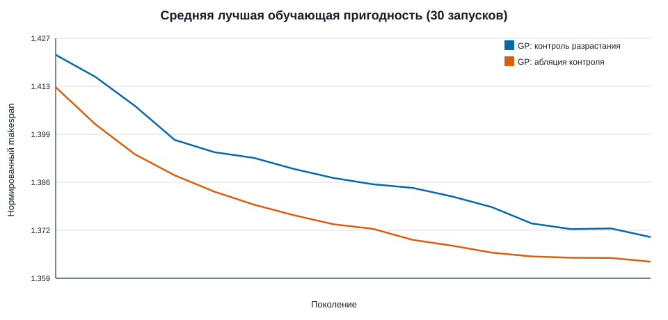
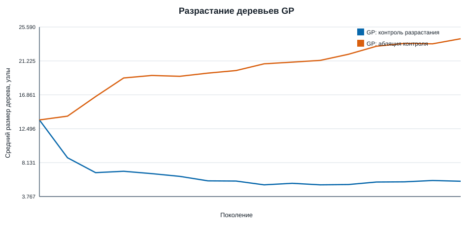
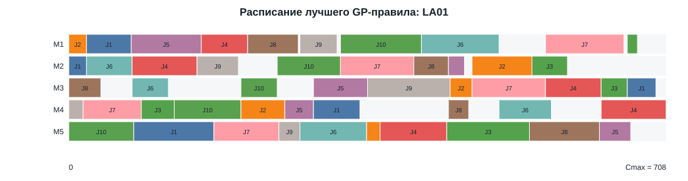

# Отчёт по лабораторной работе №4

**Дисциплина:** «Эволюционное программирование и генетические алгоритмы»  
**Вариант:** 6  
**Тема:** генетическое программирование эвристики для дискретной оптимизационной задачи JSSP

## 1. Цель и постановка

Цель — спроектировать и исследовать сложную эволюционную систему, которая автоматически строит диспетчерское правило для задачи Job Shop Scheduling Problem. Работа состоит из набора работ; каждая работа имеет фиксированную последовательность операций `(станок, длительность)`. Станок выполняет не более одной операции одновременно, а следующая операция работы может стартовать лишь после завершения предыдущей. Целевая функция:

`min Cmax`, где `Cmax` — время окончания последней операции.

Симулятор строит допустимое активное расписание: из операций с минимальным достижимым временем старта правило выбирает одну с наименьшим приоритетом. Таким образом, ограничения порядка работ и занятости станков соблюдаются конструктивно, а не штрафом.

## 2. Данные и представление

Набор воспроизводимо сформирован с seed 2026. Обучающий набор содержит восемь задач размеров 6×6…10×8. Независимый тест: эталонные FT06, FT10, LA01, LA02 и две синтетические крупные задачи 15×10, 20×10. Для оценки между задачами используется `Cmax / LB`; `LB = max(максимальная суммарная работа одной работы, максимальная нагрузка станка)`.

Особь GP — дерево выражения. Доступны терминалы `p, w, rem_ops, wait, t, dd, slack, q_len, q_work`, случайные константы 0.5, 1, 2 и функции `+ - * / min max if_gt`. Деление защищено от нуля и переполнения. Инициализация — ramped half-and-half; используются турнирная селекция, subtree crossover, subtree mutation, point mutation, hoist mutation и элитизм. Максимальная глубина равна 6.

## 3. Варианты и честность сравнения

Основное сравнение — два **идентичных по всем вычислениям** GP:

| Вариант | Отличие |
|---|---|
| GP с контролем разрастания | штраф `0.002 × размер дерева`, hoist-мутация |
| Абляция контроля | штраф и hoist отключены |

Оба используют 20 особей, 15 эволюционных шагов и восемь обучающих задач: `20 × 16 × 8 = 2 560` симуляций расписаний на запуск. Выполнено по 30 запусков, seeds 1000–1029. Прямой ГА над операционными последовательностями используется отдельно как специализированный ориентир: он оптимизирует каждый тестовый экземпляр, чего гиперэвристика принципиально не делает. Также приведены ручные правила SPT, LPT, MWKR, SLACK и FIFO.

## 4. Результаты

Полная таблица запусков: [gp_runs.csv](outputs/gp_runs.csv); сводная статистика: [summary.csv](outputs/summary.csv).

| Метод | Лучшее | Среднее | Медиана | σ | Худшее |
|---|---:|---:|---:|---:|---:|
| GP с контролем | 1.2642 | 1.3034 | 1.2993 | 0.0354 | 1.3607 |
| GP без контроля | 1.2432 | 1.3080 | 1.2988 | 0.0522 | 1.4452 |

У лучшего ручного правила MWKR среднее по шести тестовым задачам равно 1.3034. Следовательно, средний результат GP с контролем практически совпал с сильным предметным baseline, но GP самостоятельно открыл несколько компактных вариантов правила. Лучший единичный прогон контролируемого GP имеет 1.2642. Прямой ГА, обучаемый на отдельной конкретной задаче, показал, например, средние значения 1.3340 на FT06 и 2.0300 на FT10; его результаты нельзя напрямую объединять с обобщающим GP, но они дают инженерный ориентир для instance-specific поиска.

Контроль разрастания сократил средний размер деревьев с **24.6** (максимум 75) до **5.3** узла (максимум 13), среднюю глубину — с 4.3 до 1.8, и снизил стандартное отклонение результата с 0.0522 до 0.0354. Цена — немного худший экстремальный единичный запуск. Это ожидаемый и полезный компромисс: для переносимой эвристики компактность и устойчивость важнее редкой удачной, но трудно интерпретируемой формулы.

## 5. Примеры синтезированных правил

Три характерные особи из серии:

| Сложность | Формула | Тестовый показатель |
|---|---|---:|
| 3 узла | `p / w` | 1.2646 |
| 13 узлов | `(max(rem_ops,p)/w) / ((1+w)+min(wait,q_work))` | 1.2642 |
| 75 узлов | сложное условное дерево из абляции | 1.2469 |

Вторая формула — лучший контролируемый результат. Она нормирует локальную длительность и число оставшихся операций на оставшуюся работу, дополнительно учитывая ожидание и нагрузку очереди. Полное интерактивное дерево доступно в [best_rule_tree.html](outputs/best_rule_tree.html), структура JSON — в [best_rule.json](outputs/best_rule.json).

Ниже — расписание, которое это правило построило для одного из тестов; каждая полоса — операция, цвет соответствует работе.

## 6. Архитектура и проверка корректности

`gp_tree.py` отвечает за синтаксическую корректность деревьев и безопасное вычисление. `jssp.py` — единственное место, где принимаются решения расписания; он создаёт только допустимые операции. `gp_hyperheuristic.py` реализует обучение правила на наборе задач. `direct_ga.py` содержит независимое прямое представление: каждая работа повторяется в хромосоме ровно по числу своих операций, а декодер всегда берёт следующую допустимую операцию. Скрипт `run_experiments.py` генерирует CSV, SVG, HTML и JSON.

После серии дополнительно проверено, что в каждом из шести показанных расписаний число операций совпадает с размером задачи: FT06 — 36, FT10 — 100, LA01/LA02 — по 50, synthetic 15×10 — 150, 20×10 — 200. Следовательно, ни одна операция не потеряна и precedence-ограничения декодера выполняются.

## 7. Ограничения и улучшения

Симулятор строит только активные расписания; поиск не охватывает все возможные неактивные последовательности. Обучающие задачи синтетические и сравнительно малы, поэтому перенос на реальные данные требует отдельной валидации. Применён простой штраф за размер, без семантического упрощения дерева. Следующие шаги: кросс-валидация по наборам задач, многокритериальная оптимизация `Cmax`/tardiness/энергии, локальный поиск после GP-решения и параллельное оценивание популяции.

## 8. План демонстрации (5–7 минут)

1. Показать модель JSSP и её ограничения (около 1 минуты).
2. Открыть лучшее дерево и объяснить признаки/защищённые операции (1–1.5 минуты).
3. Запустить или показать команду `python3 run_experiments.py`, seeds и равный бюджет (1 минута).
4. Показать графики сходимости, разрастания и таблицу 30 запусков (1–1.5 минуты).
5. Показать диаграмму Ганта, вывод о стабильности и ограничения (1–1.5 минуты).

Готовый покадровый сценарий вынесен в [DEMO.md](DEMO.md).
